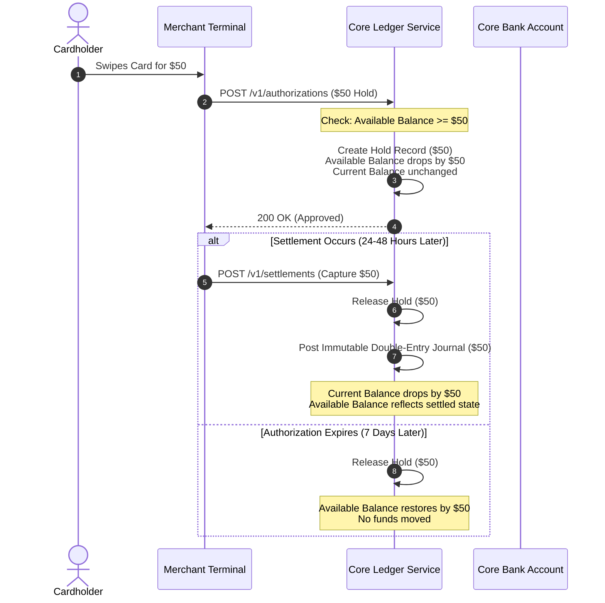

# Money Representation and Accounting Ledgers

> Production questions, architectural rules, and data models for monetary precision, double-entry bookkeeping, and ledger immutability.

---

## 1. Why must software engineers never use floating-point types for monetary values?

### The Core Problem
Binary floating-point types (`float`, `double`) use the IEEE 754 standard. These types represent numbers in base-2. Base-2 fractions cannot represent base-10 decimals like `0.10` or `0.01` accurately. 

When a computer converts `0.10` to binary floating-point, it creates an infinite repeating fraction:

```text
0.10 (base 10) = 0.0001100110011001100110011... (base 2)
```

Small rounding errors accumulate over millions of transactions. These errors cause accounting discrepancies, broken reconciliations, and regulatory audit failures.

```python
# The Floating-Point Hazard
>>> 0.1 + 0.2
0.30000000000000004

>>> balance = 0.0
>>> for _ in range(10000):
...     balance += 0.01
>>> balance
99.9999999999986  # Lost money due to float precision drift
```

### The Architectural Rule
You must store and calculate monetary amounts with one of two methods:

1. **Minor Currency Units (Integers):**
   - Store the value as an integer in the lowest unit of the currency.
   - Store US Dollars in cents (`$10.50` = `1050`).
   - Store Japanese Yen in whole units (`¥1000` = `1000`).
   - Use 64-bit integers (`BIGINT` in SQL, `int64` in Go, `BigInt` in TypeScript).

2. **Fixed-Point Decimal Types:**
   - Use arbitrary-precision decimal libraries or database decimal types.
   - Use `NUMERIC` or `DECIMAL` in SQL databases.
   - Use `Decimal` in Python or `BigDecimal` in Java.
   - Always define explicit precision and scale (for example, `DECIMAL(18, 4)`).

### Production SQL Schema Pattern

```sql
CREATE TABLE accounts (
    id UUID PRIMARY KEY DEFAULT gen_random_uuid(),
    account_number VARCHAR(34) NOT NULL UNIQUE,
    currency VARCHAR(3) NOT NULL, -- ISO 4217 code (for example: 'USD', 'EUR')
    balance_minor_units BIGINT NOT NULL DEFAULT 0,
    created_at TIMESTAMPTZ NOT NULL DEFAULT clock_timestamp()
);

-- Constraint: Balance can require explicit sign control depending on account type
ALTER TABLE accounts ADD CONSTRAINT chk_currency_code_length 
    CHECK (length(currency) = 3);
```

---

## 2. How must financial systems handle currency scale, fractional units, and rounding?

### Currency Scale Variations (ISO 4217)
Currencies do not share a single decimal scale. Different currencies use different numbers of decimal places:

| Currency | ISO 4217 Code | Minor Unit Exponent | Scale Factor | Example Input | Stored Value |
| :--- | :--- | :--- | :--- | :--- | :--- |
| Japanese Yen | `JPY` | 0 | 1 | ¥500 | `500` |
| US Dollar | `USD` | 2 | 100 | \$12.50 | `1250` |
| Bahraini Dinar | `BHD` | 3 | 1000 | BD 5.250 | `5250` |
| Bitcoin | `BTC` | 8 | 100,000,000 | 0.00150000 BTC | `150000` |
| Ethereum (Wei) | `ETH` | 18 | 10^18 | 1.0 ETH | `1000000000000000000` |

### Fractional Operations and Sub-Cent Math
Financial operations frequently generate fractional units:
- Percentage fee calculations (for example: `2.9% + $0.30`).
- Prorated subscription billing.
- Foreign exchange (FX) currency conversions.
- Accrued loan interest calculations.

When fractional units occur, your system must not discard fractions silently.

### Rounding Strategies
You must select an explicit rounding algorithm across your entire payment pipeline.

1. **Half-Even Rounding (Bankers' Rounding):**
   - Rounds to the nearest even number when the fraction is exactly halfway (`0.5`).
   - `2.5` rounds to `2`.
   - `3.5` rounds to `4`.
   - This method reduces statistical bias over large volumes of transactions.
   - This method is the default for IEEE 754 and financial accounting standards.

2. **Half-Up Rounding (Commercial Rounding):**
   - Rounds up to the next integer if the fraction is `0.5` or greater.
   - `2.5` rounds to `3`.
   - `3.5` rounds to `4`.
   - Common in consumer billing and invoicing.

3. **Truncation (Floor):**
   - Drops all fractional digits.
   - Never use truncation for final payment settlement unless a financial agreement requires it.

### The Fractional Allocation Pattern
When you divide an amount between multiple parties, rounding can destroy or create cents. You must allocate remainders deterministically.

```python
from decimal import Decimal, ROUND_HALF_EVEN

def allocate_amount(total_cents: int, ratios: list[int]) -> list[int]:
    """
    Distributes an integer amount according to integer ratios without losing cents.
    Applies the largest remainder method (Hare-Niemeyer method).
    """
    total_ratio = sum(ratios)
    shares = []
    remainders = []

    for index, ratio in enumerate(ratios):
        # Calculate raw share
        raw = (total_cents * ratio) / total_ratio
        base_share = int(raw)
        shares.append(base_share)
        remainders.append((raw - base_share, index))

    # Calculate remainder cents to allocate
    leftover = total_cents - sum(shares)

    # Sort by largest remainder descending
    remainders.sort(key=lambda x: x[0], reverse=True)

    # Distribute leftover cents to largest remainders
    for i in range(leftover):
        target_index = remainders[i][1]
        shares[target_index] += 1

    return shares

# Example: Split $100.00 (10000 cents) three equal ways (1:1:1)
# 10000 / 3 = 3333.3333...
# Result guarantees total sum remains exactly 10000 cents:
# [3334, 3333, 3333] -> Sum = 10000
```

---

## 3. What is double-entry bookkeeping, and why must financial platforms require it?

### Single-Entry vs. Double-Entry Architecture
In single-entry systems, an engineer writes code like this:

```sql
-- DANGEROUS: Single-Entry Anti-Pattern
UPDATE user_balances 
SET balance = balance - 1000 
WHERE user_id = 'user-1';

UPDATE user_balances 
SET balance = balance + 1000 
WHERE user_id = 'user-2';
```

Single-entry systems have critical architectural flaws:
- They do not track the origin of funds.
- If one query fails or times out, the system creates or destroys money.
- They lack auditability because you cannot reconstruct previous balances.
- They cannot verify total system integrity with mathematical proofs.

### The Double-Entry Core Formula
In double-entry bookkeeping, every financial event is recorded as a **balanced journal entry**. Every entry contains at least two postings:
1. At least one **Debit**.
2. At least one **Credit**.

The sum of all debits must equal the sum of all credits for every transaction:

$$\sum \text{Debits} - \sum \text{Credits} = 0$$

### The Accounting Equation
All accounts belong to one of five fundamental account types:

$$\text{Assets} = \text{Liabilities} + \text{Equity} + (\text{Revenue} - \text{Expenses})$$

| Account Type | Normal Balance | Increased By | Decreased By | Platform Examples |
| :--- | :--- | :--- | :--- | :--- |
| **Asset** | Debit | Debit | Credit | Operating Bank Account, Cash in Clearing |
| **Liability** | Credit | Credit | Debit | User Deposit Wallets, Unsettled Merchant Payables |
| **Equity** | Credit | Credit | Debit | Retained Earnings, Founder Capital |
| **Revenue** | Credit | Credit | Debit | Payment Processing Fees Collected |
| **Expense** | Debit | Debit | Credit | Interchange Fees Paid, Network Fees |

### Real-World Example: Customer Adds \$100 to Platform
When a user deposits \$100 into their wallet:
1. The platform's bank account (Asset) increases by \$100 $\rightarrow$ **Debit Asset**.
2. The customer's wallet balance (Liability) increases by \$100 $\rightarrow$ **Credit Liability**.

```text
Journal Entry: User Deposit #TX-901
-----------------------------------------------------------
Debit:  Assets:Bank:FBO_Account             +$100.00
Credit: Liabilities:Customer_Wallets:User_1 +$100.00
-----------------------------------------------------------
Total Debits: $100.00 | Total Credits: $100.00 (Balanced)
```

---

## 4. Why must financial ledgers be append-only and immutable?

### The Principle of Immutability
A ledger is a legal, permanent record of financial history. 

You must apply these rules to your database ledger:
- **Never execute `UPDATE` statements on posted ledger records.**
- **Never execute `DELETE` statements on ledger records.**
- **Only execute `INSERT` statements.**

### Error Correction with Reversals
If an operator enters an incorrect amount or a transaction fails after posting:
1. Do not edit the original row.
2. Create a new transaction that negates the previous entry (a **Reversal**).
3. Create a new, correct transaction (a **Correction**).

```text
Original Transaction (Incorrect: transferred $50 instead of $30):
Debit:  Assets:OperatingAccount   $50.00
Credit: Liabilities:VendorPayable $50.00

Step 1: Reversal Transaction (Exact mirror):
Debit:  Liabilities:VendorPayable $50.00
Credit: Assets:OperatingAccount   $50.00

Step 2: Correcting Transaction:
Debit:  Assets:OperatingAccount   $30.00
Credit: Liabilities:VendorPayable $30.00
```

### Benefits of Append-Only Architecture
1. **Deterministic Replay:** You can compute the exact account balance at any second in the past ($t$).
2. **Fraud Detection:** Internal actors cannot modify historical records without detection.
3. **Audit Compliance:** External regulators (SOC 1, SOC 2, PCI, Central Banks) verify that records cannot be altered.
4. **Cryptographic Tamper-Evidence:** You can link entries together using SHA-256 hashes (a ledger chain or Merkle tree) to prove history remains unchanged.

---

## 5. What are the differences between ledger balance, available balance, and pending holds?

### Balance Type Definitions
A financial system cannot track account state with a single balance number. You must separate balances into three distinct concepts:

1. **Current Balance (Ledger Balance):**
   - The total amount of settled funds legally in the account.
   - Updated only when transactions clear and settle completely.

2. **Pending Holds (Authorizations / Reservations):**
   - Funds reserved for in-flight or authorized transactions.
   - Examples include card authorizations, gas station pre-authorizations, or outbound transfers in clearing.
   - Money has not moved yet, but the user cannot spend this money again.

3. **Available Balance:**
   - The actual spending power of the user right now.
   - Calculated as:

$$\text{Available Balance} = \text{Current Balance} - \text{Active Holds} + \text{Overdraft / Credit Limit}$$

### Lifecycle of an Authorization Hold



---

## 6. How do you design a high-throughput, deadlock-free database schema for account ledgers?

### The Hot-Account Concurrency Problem
In double-entry ledgers, some accounts receive extreme traffic:
- Platform fee accounts.
- Merchant settlement accounts.
- Central bank clearing accounts.

If transactions lock rows with `SELECT ... FOR UPDATE`, concurrent payments will block each other. If two concurrent transactions lock accounts in opposite orders, the database throws a **deadlock**:

```text
Tx 1: Locks Account A -> Waits to lock Account B
Tx 2: Locks Account B -> Waits to lock Account A
==> DEADLOCK DETECTED (PostgreSQL Error 40P01)
```

### Rules to Eliminate Deadlocks
1. **Always Sort Account IDs:**
   - If a transaction locks multiple accounts, sort account IDs alphanumerically before acquiring locks.
   - Both `Tx 1` and `Tx 2` lock Account A first, then Account B. Deadlocks become mathematically impossible.

2. **Never Update Balance Rows on the Critical Write Path:**
   - Write immutable entries to an append-only postings table.
   - Do not run `UPDATE accounts SET balance = balance + :amount`.
   - Calculate account balances by summing postings or reading asynchronous materialized balance snapshots.

### Complete Production PostgreSQL Schema

```sql
-- 1. Accounts Table (Metadata only, no mutable balances on write path)
CREATE TABLE accounts (
    id UUID PRIMARY KEY DEFAULT gen_random_uuid(),
    account_number VARCHAR(64) NOT NULL UNIQUE,
    account_type VARCHAR(16) NOT NULL, -- 'ASSET', 'LIABILITY', 'EQUITY', 'REVENUE', 'EXPENSE'
    currency VARCHAR(3) NOT NULL,
    status VARCHAR(16) NOT NULL DEFAULT 'ACTIVE', -- 'ACTIVE', 'FROZEN', 'CLOSED'
    created_at TIMESTAMPTZ NOT NULL DEFAULT clock_timestamp()
);

-- 2. Journals Table (Transaction Header)
CREATE TABLE journals (
    id UUID PRIMARY KEY DEFAULT gen_random_uuid(),
    idempotency_key VARCHAR(128) NOT NULL UNIQUE,
    description TEXT NOT NULL,
    posted_at TIMESTAMPTZ NOT NULL DEFAULT clock_timestamp()
);

-- 3. Postings Table (Immutable Double-Entry Lines)
CREATE TABLE postings (
    id UUID PRIMARY KEY DEFAULT gen_random_uuid(),
    journal_id UUID NOT NULL REFERENCES journals(id) ON DELETE RESTRICT,
    account_id UUID NOT NULL REFERENCES accounts(id) ON DELETE RESTRICT,
    amount BIGINT NOT NULL, -- Positive = Debit, Negative = Credit (or use explicit direction)
    direction VARCHAR(6) NOT NULL, -- 'DEBIT' or 'CREDIT'
    sequence_num INT NOT NULL,
    created_at TIMESTAMPTZ NOT NULL DEFAULT clock_timestamp(),
    
    CONSTRAINT chk_direction CHECK (direction IN ('DEBIT', 'CREDIT')),
    CONSTRAINT chk_positive_amount CHECK (amount > 0)
);

-- Index for fast account history queries
CREATE INDEX idx_postings_account_time ON postings (account_id, created_at DESC);
CREATE INDEX idx_postings_journal ON postings (journal_id);

-- 4. Holds Table (Pending Authorizations)
CREATE TABLE balance_holds (
    id UUID PRIMARY KEY DEFAULT gen_random_uuid(),
    account_id UUID NOT NULL REFERENCES accounts(id) ON DELETE RESTRICT,
    amount BIGINT NOT NULL CHECK (amount > 0),
    status VARCHAR(16) NOT NULL DEFAULT 'ACTIVE', -- 'ACTIVE', 'SETTLED', 'EXPIRED', 'VOIDED'
    expires_at TIMESTAMPTZ NOT NULL,
    created_at TIMESTAMPTZ NOT NULL DEFAULT clock_timestamp()
);

CREATE INDEX idx_holds_account_active ON balance_holds (account_id) WHERE status = 'ACTIVE';

-- 5. Materialized Account Snapshots (For low-latency read path)
CREATE TABLE account_balance_snapshots (
    account_id UUID NOT NULL REFERENCES accounts(id) ON DELETE CASCADE,
    last_journal_id UUID NOT NULL REFERENCES journals(id),
    cleared_balance BIGINT NOT NULL,
    snapshot_at TIMESTAMPTZ NOT NULL DEFAULT clock_timestamp(),
    PRIMARY KEY (account_id, snapshot_at)
);
```

### Transaction Insertion Guarantee (Zero-Sum Verification)
You can verify the double-entry balance inside a database trigger or a transactional stored procedure:

```sql
CREATE OR REPLACE FUNCTION verify_journal_zero_sum()
RETURNS TRIGGER AS $$
DECLARE
    net_sum BIGINT;
BEGIN
    -- Sum Debits (+1) and Credits (-1) for the journal
    SELECT COALESCE(SUM(
        CASE 
            WHEN direction = 'DEBIT' THEN amount 
            WHEN direction = 'CREDIT' THEN -amount 
        END
    ), 0)
    INTO net_sum
    FROM postings
    WHERE journal_id = NEW.journal_id;

    IF net_sum <> 0 THEN
        RAISE EXCEPTION 'Unbalanced journal entry %. Sum of debits and credits must be zero. Current net: %', 
            NEW.journal_id, net_sum;
    END IF;

    RETURN NEW;
END;
$$ LANGUAGE plpgsql;

-- Use a CONSTRAINT TRIGGER deferred to the end of the transaction
CREATE CONSTRAINT TRIGGER trg_verify_journal_balance
    AFTER INSERT OR UPDATE ON postings
    DEFERRABLE INITIALLY DEFERRED
    FOR EACH ROW
    EXECUTE FUNCTION verify_journal_zero_sum();
```

---

## 7. Summary Checklist for Production Ledgers

Before you release a financial ledger to production, verify each requirement:

- [ ] **Exact Types:** All monetary balances use 64-bit integers (minor units) or exact fixed-point decimals. No floating-point types exist in code or schemas.
- [ ] **Scale Explicit:** The system explicitly defines currency decimals (for example: USD = 2, JPY = 0).
- [ ] **Double-Entry Enforced:** Every transaction contains matching debit and credit entries. The net sum of debits and credits is zero.
- [ ] **No In-Place Updates:** The ledger tables prohibit `UPDATE` and `DELETE` commands. Compensating entries execute reversals.
- [ ] **Three-Part Balances:** The application separates current balance, active pending holds, and available balance.
- [ ] **Deterministic Lock Order:** Multi-account transactions sort account identifiers before acquiring locks to prevent deadlocks.
- [ ] **Zero-Sum Triggers:** The database prevents unbalanced transactions with deferred constraint checks.
