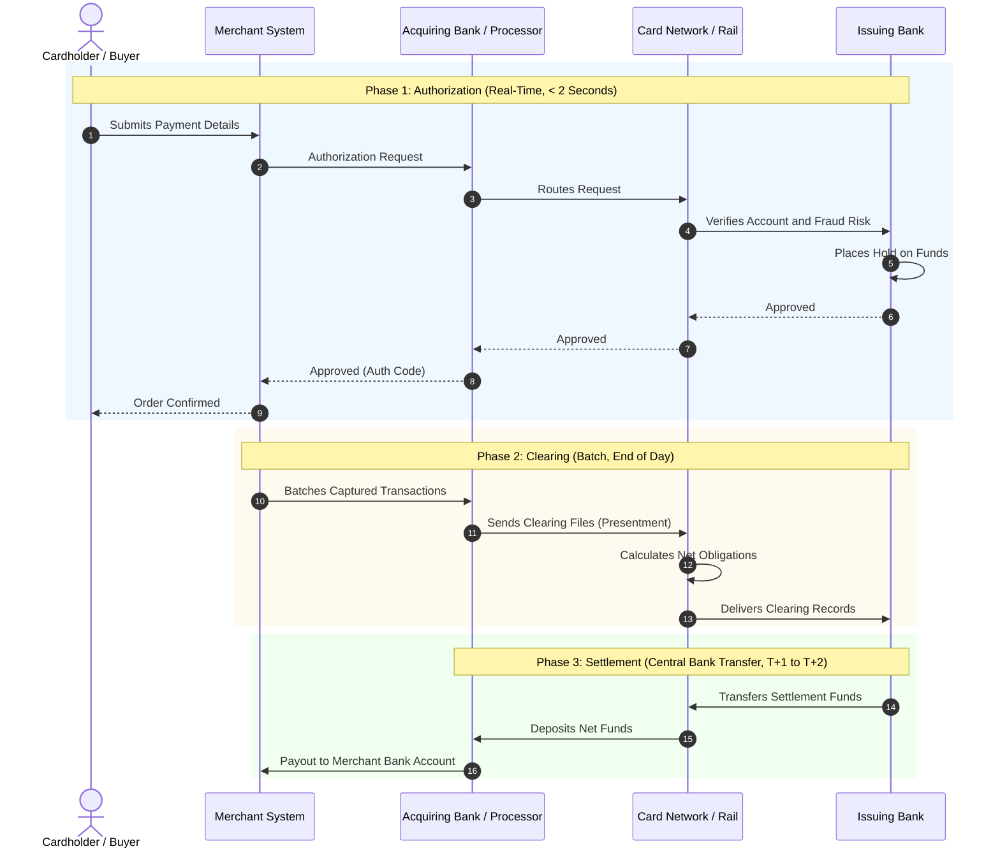
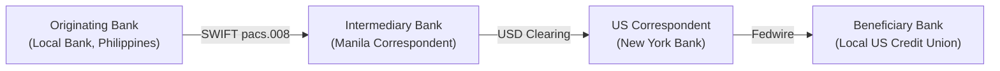

# Payment Rails, Clearing, and Settlement

> Production questions, architectural rules, and operational mechanics for card networks, ACH, RTGS, FedNow, and cross-border settlement.

---

## 1. What is the technical difference between authorization, clearing, and settlement?

### The Core Problem
Many software engineers assume that a successful payment API response means money has moved. In banking systems, this assumption is false. 

Money movement occurs across three distinct, decoupled phases:
1. **Authorization:** The verification of funds and reservation of credit.
2. **Clearing:** The exchange of transaction details between financial institutions.
3. **Settlement:** The actual transfer of central bank funds between accounts.

Confusing these three phases causes ledger imbalances, incorrect balance displays, and unhedged credit risk.

### Phase Definitions and Mechanics



### Key Differences Summary

| Phase | Latency | Data Exchanged | Legal Financial Status | Reversible? |
| :--- | :--- | :--- | :--- | :--- |
| **Authorization** | Real-time (100–500 ms) | Amount, card token, merchant ID | Funds reserved; no ownership transfer | Yes (Void / Auth Reversal) |
| **Clearing** | Batch (hours to 1 day) | Full transaction metadata, fees | Final terms agreed by institutions | Yes (Chargeback / Dispute) |
| **Settlement** | T+1 to T+3 days | Net settlement balance files | Legal transfer of central bank money | Irrevocable between banks |

---

## 2. How do card networks operate the authorization and capture lifecycle?

### Dual-Message vs. Single-Message Systems
Card networks operate two distinct processing models:

1. **Dual-Message System (Signature / E-Commerce):**
   - Authorization and clearing occur separately.
   - The merchant submits an authorization request first.
   - The merchant submits a capture request later (in a batch file).
   - Common for Visa and Mastercard credit transactions, hotel bookings, and e-commerce.

2. **Single-Message System (PIN Debit / ATM):**
   - Authorization and clearing occur in the same message.
   - The issuer debits the account immediately upon authorization.
   - Common for debit card transactions and ATM cash withdrawals.

### The Capture Window and Auth Degradation
When an issuer approves an authorization, the hold has an expiration window:
- Standard e-commerce holds expire after 7 days.
- Hotel and car rental holds can remain open for 30 days.
- If a merchant captures a transaction after the hold expires, the transaction suffers **authorization degradation**.
- Degradation increases the interchange fee rate paid by the merchant.
- If the cardholder spends their balance before late capture, the capture can fail, causing merchant capital loss.

### Incremental Authorizations
For variable-amount transactions (such as hotels, fuel pumps, and ride shares), systems use **incremental authorizations**:

```text
1. Initial Authorization:   $50.00  (Hold placed at check-in)
2. Incremental Auth #1:     +$30.00 (Room service added)
3. Total Authorized Hold:   $80.00
4. Final Settlement Capture:$80.00  (Captured at check-out)
```

---

## 3. How does the Automated Clearing House (ACH) rail work, and why does it have settlement lag?

### Batch-Processing Mechanics
The Automated Clearing House (ACH) network in the United States is a **store-and-forward batch system**. It is operated by the Federal Reserve and The Clearing House (EPN).

The ACH network does not process transactions in real time. Instead, an Originating Depository Financial Institution (ODFI) collects transactions, groups them into NACHA-formatted files, and submits them at scheduled processing windows.

### ACH Credit vs. ACH Debit

```text
ACH Credit (Push):
Payer -> Instructs Bank -> Pushes Funds -> Payee Bank Account
Low fraud risk for payee. Payer initiates the transfer.

ACH Debit (Pull):
Payee -> Instructs Bank -> Pulls Funds -> Payer Bank Account
High fraud risk. Requires prior written authorization (Mandate).
```

### NACHA File Structure
ACH files use a strict 94-character fixed-width text format:

```text
101 021000021 123456789 261111 1200 A 094 101 ODFI_NAME              ORIGINATOR_NAME
5200 COMPANY_NAME        DISCR_DATA 1234567890 PPD PAYROLL   261111 261112   1 02100002 0000001
622 021000021 123456789012 0000050000 EMP_ID_99    DOE JOHN                 0 021000020000001
8200 000001 0002100002 000000000000 000000050000 1234567890                         02100002 0000001
9000001 000001 00000001 0002100002 000000000000 000000050000
```

### The ACH Return Risk Window
An ACH debit can be returned after settlement. The Receiving Depository Financial Institution (RDFI) returns transactions using specific return codes:

| Return Code | Description | Standard Return Window |
| :--- | :--- | :--- |
| **R01** | Insufficient Funds | 2 Banking Days |
| **R02** | Account Closed | 2 Banking Days |
| **R03** | No Account / Unable to Locate | 2 Banking Days |
| **R10** | Customer Advises Unauthorized Notice | **Up to 60 Calendar Days** |
| **R29** | Corporate Customer Advises Not Authorized | 2 Banking Days |

> [!WARNING]
> Because consumer accounts allow unauthorized debit disputes (R10) for up to 60 days, ACH debits are never truly irrevocable. Financial platforms must implement holding periods or risk-based withdrawal limits before releasing funds from ACH pulls.

---

## 4. How do modern Real-Time Gross Settlement (RTGS) and instant payment rails work?

### Gross Settlement vs. Net Settlement
Financial networks settle funds using two distinct methods:

1. **Deferred Net Settlement (DNS):**
   - The network aggregates all payments between banks over a time window (for example: ACH, SEPA Core).
   - Only the net difference moves between central bank reserve accounts at the end of the window.
   - Highly capital efficient, but introduces interbank credit risk.

2. **Real-Time Gross Settlement (RTGS):**
   - Each transaction settles individually and immediately across central bank reserve accounts.
   - Settlement is final, irrevocable, and unconditional.
   - Examples include Fedwire, CHAPS, TARGET2, and modern instant rails (FedNow, RTP, SEPA Instant).

### Instant Payment Comparison

| Rail | Region | Operating Hours | Max Transaction Limit | Settlement Model | Messaging Standard |
| :--- | :--- | :--- | :--- | :--- | :--- |
| **Fedwire** | USA | 21.5 hours / business days | No Limit | RTGS | Fedwire Proprietary / ISO 20022 |
| **FedNow** | USA | 24/7/365 | \$500,000 (Default) | Immediate Gross | ISO 20022 (`pacs.008`) |
| **RTP** | USA | 24/7/365 | \$1,000,000 | Immediate Gross | ISO 20022 (`pacs.008`) |
| **SEPA Instant**| Eurozone | 24/7/365 | €100,000 | Immediate Gross | ISO 20022 (`pacs.008`) |
| **Faster Payments**| UK | 24/7/365 | £1,000,000 | Deferred Net / RTGS | ISO 8583 / ISO 20022 |

### Architectural Implication: Instant Irrevocability
Instant payment rails do not support pull debits. They only support credit transfers (push payments).

Because instant payments settle in seconds and cannot be reversed by the sender:
- Fraud detection must execute inline within a strict 500 ms SLA.
- Sanctions and AML screening must run before message dispatch.
- Account balance reservation must be strictly synchronous.

---

## 5. How does cross-border money movement work via SWIFT and correspondent banking?

### Nostro and Vostro Account Mechanics
Cross-border payments rely on the **correspondent banking network**. Banks do not have accounts in every country. Instead, they hold bilateral accounts with foreign banks:

- **Nostro Account ("Our money in your bank"):** An account that a domestic bank holds at a foreign bank in the foreign bank's currency.
- **Vostro Account ("Your money in our bank"):** An account that a foreign partner holds at the domestic bank in the domestic currency.

```text
Example: Bank A in New York transfers USD to Bank B in Frankfurt.
Bank B maintains a USD Vostro account at Bank A.
Bank A debits Bank B's Vostro account.
No physical or cross-border cash moves across borders. Book entries adjust balances.
```

### The Correspondent Banking Chain
When two banks do not have a direct bilateral relationship, they must route payments through intermediary correspondent banks:



### The Cost of Multi-Hop Routing
Each intermediary bank in the chain:
- Deducts a processing fee (lifting fee).
- Applies an FX markup if currency conversion occurs.
- Adds latency (typically 1 to 4 business days).
- Conducts independent sanctions and AML checks, creating compliance holds.

---

## 6. Summary Checklist for Payment Rails Integration

Before deploying payment rail integrations to production, verify each rule:

- [ ] **State Decoupling:** Authorization holds are decoupled from settlement records in the database.
- [ ] **Auth Expiration Handlers:** Automated background jobs detect expired authorizations and release ledger holds.
- [ ] **ACH Risk Windows:** Funds from incoming ACH debits are held for at least 2 to 5 business days before user withdrawal.
- [ ] **Inline Instant Screening:** Sanctions screening and fraud scoring execute synchronously within 300 ms for instant rails (FedNow/RTP).
- [ ] **Fee Accounting:** Intermediary lifting fees and network interchange are tracked separately from gross settlement amounts.
- [ ] **Rail Idempotency:** All payment initiation requests transmit a client-generated UUID to prevent duplicate rail submissions.
