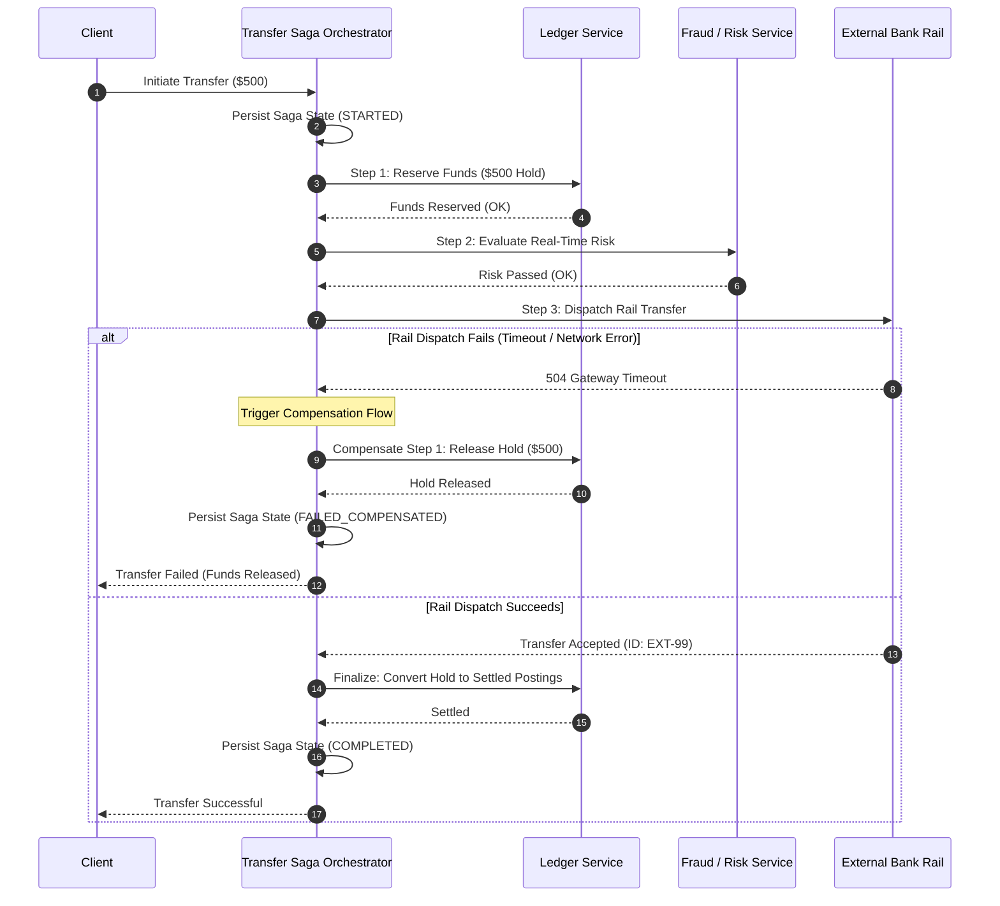

# Distributed Transactions and Idempotency

> Production questions, architectural rules, and failure handling for sagas, idempotency keys, race conditions, and replay attacks.

---

## 1. Why does Two-Phase Commit (2PC) fail in modern distributed financial systems?

### The Core Problem
In monolithic systems, a database transaction (ACID) guarantees all-or-nothing execution. In a microservices architecture, a financial transaction often spans multiple internal databases and external bank APIs:

- Core ledger database (Internal PostgreSQL)
- Card issuing processor (External API via Marqeta or Galileo)
- Fraud evaluation service (Internal Redis / DynamoDB)
- Notification service (Kafka / Twilio)

Engineers sometimes attempt to use **Two-Phase Commit (2PC)** or **XA transactions** across these boundaries. In production, 2PC creates catastrophic operational failures.

### Why 2PC Fails in Production
1. **The Blocking Coordinator Problem:**
   - In Phase 1 (Prepare), all participating nodes acquire database locks.
   - If the coordinator node crashes before Phase 2 (Commit), all nodes remain locked indefinitely.
   - Locked database rows cause request thread pools to starve, crashing the entire service.

2. **External APIs Do Not Support 2PC:**
   - External banking rails and payment processors (such as Stripe, Visa, or Fedwire) do not expose 2PC prepare hooks.
   - Once an HTTP request instructs a banking gateway to move money, that instruction cannot be "prepared" without moving funds.

3. **High Latency and Availability Loss:**
   - According to the CAP theorem, 2PC chooses consistency over availability ($CP$).
   - Network partitions or high latency over WAN connections cause global transaction timeouts and dropped throughput.

---

## 2. How do you design a reliable Saga pattern with compensating transactions for money movement?

### The Saga Pattern
A Saga is a sequence of local transactions. Each local transaction updates data within a single service and publishes an event or message. 

If any local transaction fails, the saga executes a series of **compensating transactions** that undo the changes made by earlier steps.

### Orchestration vs. Choreography
In financial systems, you must always choose **Orchestration-based Sagas** over Choreography:

- **Choreography (Event-Driven):** Services listen to events and decide next steps independently. In complex workflows, event chains become difficult to audit, trace, and debug.
- **Orchestration (Centralized Coordinator):** A dedicated orchestrator state machine controls every step, logs state transitions to disk, and executes compensating actions explicitly.

### Saga State Machine Lifecycle



### What Happens When a Compensating Transaction Fails?
Compensating transactions can also fail (due to network partitions or target service downtime). 

You must enforce two production rules:
1. **Compensating actions must be idempotent and retryable indefinitely.** Use exponential backoff with jitter until the compensating action succeeds.
2. **If retries exceed the maximum threshold, raise an alert to a human break queue.** Financial systems must never drop failed compensations silently.

---

## 3. How must software engineers implement end-to-end idempotency in financial APIs?

### The Core Problem
When a client sends an HTTP payment request, network failures can interrupt the response:

```text
Client ---> POST /v1/payments ($100) ---> Server (Charges Card Successfully)
Client <--- [NETWORK CONNECTION DROPS] <--- Server (Response Lost)
```

The client does not know if the charge succeeded. If the client retries the request, an unsafe server will execute a second charge, resulting in a **double charge**.

### The Idempotency Key Pattern
Financial APIs must require an `Idempotency-Key` HTTP header for all mutating requests (`POST`, `PATCH`).

An idempotency implementation requires four components:
1. **Client-Supplied Unique Key:** A UUID (version 4 or version 7) generated by the client before the first attempt.
2. **Atomic Lock / Reservation:** A database record that reserves the idempotency key before work starts.
3. **Payload Fingerprint:** A SHA-256 hash of the request body to detect payload tampering on retried keys.
4. **Cached Response Storage:** The exact HTTP status code and response payload cached permanently or for a long TTL (for example: 24 to 72 hours).

### Complete PostgreSQL Idempotency Table Schema

```sql
CREATE TABLE idempotency_records (
    key VARCHAR(128) NOT NULL,
    scope VARCHAR(64) NOT NULL, -- e.g., 'merchant_id:12345'
    request_hash VARCHAR(64) NOT NULL, -- SHA-256 of request path and body
    status VARCHAR(16) NOT NULL, -- 'PROCESSING', 'RESOLVED'
    response_code INT NULL,
    response_body JSONB NULL,
    created_at TIMESTAMPTZ NOT NULL DEFAULT clock_timestamp(),
    locked_until TIMESTAMPTZ NOT NULL, -- Prevents concurrent stampedes
    PRIMARY KEY (scope, key)
);

CREATE INDEX idx_idempotency_locked ON idempotency_records (locked_until) 
    WHERE status = 'PROCESSING';
```

### Production Idempotency Flow Logic

```python
import hashlib
import json
import time

def process_idempotent_payment(scope: str, idempotency_key: str, payload: dict, db_conn):
    payload_bytes = json.dumps(payload, sort_keys=True).encode("utf-8")
    request_hash = hashlib.sha256(payload_bytes).hexdigest()
    lock_duration_seconds = 30
    locked_until = time.time() + lock_duration_seconds

    with db_conn.cursor() as cur:
        # Atomic lock reservation
        cur.execute(
            """
            INSERT INTO idempotency_records (scope, key, request_hash, status, locked_until)
            VALUES (%s, %s, %s, 'PROCESSING', to_timestamp(%s))
            ON CONFLICT (scope, key) DO UPDATE 
                SET locked_until = EXCLUDED.locked_until
                WHERE idempotency_records.status = 'PROCESSING' 
                  AND idempotency_records.locked_until < clock_timestamp()
            RETURNING status, request_hash, response_code, response_body;
            """,
            (scope, idempotency_key, request_hash, locked_until)
        )
        record = cur.fetchone()

        # If row existed and is already RESOLVED, return cached response
        if record and record['status'] == 'RESOLVED':
            if record['request_hash'] != request_hash:
                raise ValueError("Idempotency Key Conflict: Request payload does not match original request.")
            return record['response_code'], record['response_body']

        # If another concurrent worker is currently PROCESSING this key
        if not record:
            raise ConcurrentRequestError("Request currently processing. Retry after backoff.")

    # Execute actual financial transfer
    try:
        status_code, response_data = execute_money_transfer(payload)

        # Store response atomically
        with db_conn.cursor() as cur:
            cur.execute(
                """
                UPDATE idempotency_records 
                SET status = 'RESOLVED',
                    response_code = %s,
                    response_body = %s
                WHERE scope = %s AND key = %s;
                """,
                (status_code, json.dumps(response_data), scope, idempotency_key)
            )
            db_conn.commit()

        return status_code, response_data

    except Exception as e:
        # Release key on non-retriable failure so client can remediate
        with db_conn.cursor() as cur:
            cur.execute(
                "DELETE FROM idempotency_records WHERE scope = %s AND key = %s;",
                (scope, idempotency_key)
            )
            db_conn.commit()
        raise e
```

---

## 4. How do you prevent race conditions and concurrent double-spend attacks?

### The Race Condition Attack Vector
In a double-spend attack, a malicious user submits two identical withdrawal requests at the exact same millisecond:

```text
Request A (Withdraw $100) ---> [Worker 1] ---> Reads Balance: $100 ---> OK
Request B (Withdraw $100) ---> [Worker 2] ---> Reads Balance: $100 ---> OK
Both workers approve! Account drops to -$100 (Uncontrolled Overdraft).
```

### Prevention Strategy 1: Pessimistic Row Locking
You must lock the account row within the database transaction before reading the balance:

```sql
BEGIN;

-- Acquires an exclusive row-level lock
SELECT cleared_balance 
FROM accounts 
WHERE id = 'acct-1234' 
FOR UPDATE;

-- Application checks if balance >= withdrawal_amount
-- Insert immutable posting
INSERT INTO postings (account_id, amount, direction) 
VALUES ('acct-1234', 10000, 'DEBIT');

COMMIT; -- Row lock released here
```

### Prevention Strategy 2: Check Constraints in SQL
You can enforce non-negative balances at the storage engine level with database constraints:

```sql
ALTER TABLE account_balances 
    ADD CONSTRAINT chk_non_negative_balance 
    CHECK (cleared_balance >= 0);
```

If two concurrent transactions attempt to overdraw the balance, the second transaction fails with an explicit database constraint violation.

---

## 5. How do you protect financial webhooks and APIs against replay attacks?

### What is a Replay Attack?
A malicious actor intercepts a valid signed webhook message (for example: `payment.succeeded` for \$10,000) and re-sends the exact same message to your server multiple times. 

If your server only verifies the cryptographic signature without checking time and novelty, it will credit the customer account multiple times.

### Three Defense Mechanisms for Webhooks

1. **HMAC-SHA256 Signature Verification:**
   - The sender signs the payload using a shared secret.
   - The receiver recomputes the HMAC and verifies equality using constant-time string comparison.

2. **Timestamp Verification (Tolerance Window):**
   - The sender includes a timestamp in the signature header (for example: `t=1700000000`).
   - The signature is calculated over both the timestamp and the payload:
     $$\text{Signature} = \text{HMAC-SHA256}(\text{Secret}, t + "." + \text{Body})$$
   - The receiver rejects any webhook whose timestamp is older than a tolerance window (typically 300 seconds).

3. **Event ID Deduplication Table:**
   - Every webhook payload contains a unique event identifier (`evt_id`).
   - Store processed event IDs in a database with a unique constraint.

```python
import hmac
import hashlib
import time

def verify_fintech_webhook(payload: bytes, header_signature: str, secret: str, tolerance_seconds: int = 300) -> bool:
    # Header format: t=1700000000,v1=abc123def456...
    parts = dict(item.split("=") for item in header_signature.split(","))
    timestamp = int(parts.get("t", 0))
    signature = parts.get("v1", "")

    # 1. Reject expired timestamps to stop replay attacks
    current_time = int(time.time())
    if abs(current_time - timestamp) > tolerance_seconds:
        raise ValueError("Webhook timestamp is outside tolerance window.")

    # 2. Recompute expected signature over timestamp + '.' + payload
    signed_payload = f"{timestamp}.".encode("utf-8") + payload
    expected_signature = hmac.new(
        secret.encode("utf-8"),
        signed_payload,
        hashlib.sha256
    ).hexdigest()

    # 3. Constant-time string comparison to prevent timing attacks
    if not hmac.compare_digest(expected_signature, signature):
        raise ValueError("Invalid cryptographic webhook signature.")

    return True
```

---

## 6. Summary Checklist for Distributed Financial Transactions

Before deploying distributed payment systems, verify each safeguard:

- [ ] **No 2PC Across Services:** Microservices use Orchestrated Sagas instead of Two-Phase Commit.
- [ ] **Idempotency Keys Required:** All mutating financial endpoints require an idempotency key header.
- [ ] **Request Fingerprinting:** Idempotency verification validates that the request body hash matches the initial key registration.
- [ ] **Strict Row Locking:** Balance checks use pessimistic locking (`FOR UPDATE`) or database check constraints to prevent double-spending.
- [ ] **Replay Defense:** Webhook verifiers validate timestamps within a 300-second window and enforce event ID deduplication.
- [ ] **Indefinite Compensations:** All saga compensating actions are idempotent and run until successful or routed to a monitored break queue.
