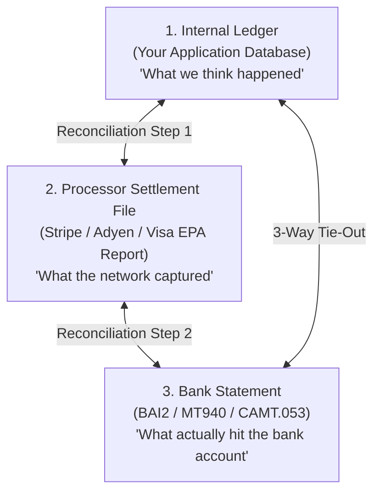
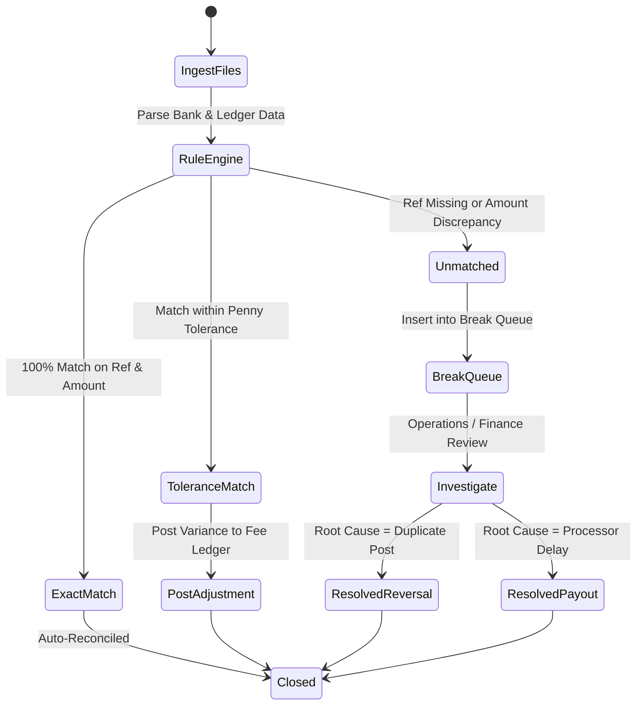
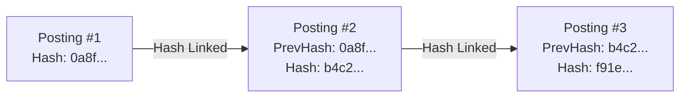

# Reconciliation and Auditability

> Production questions, matching algorithms, break queue management, journal generation, and cryptographic ledger integrity.

---

## 1. What is financial reconciliation, and why is external data required to verify internal ledgers?

### The Core Problem
An internal database is not the ultimate source of truth for money. 

Your application database can record that a \$50,000 vendor wire was sent. However, external real-world failures can happen:
- The correspondent bank blocked the wire for AML review.
- The receiving bank rejected the wire due to an invalid routing number.
- The payment gateway deducted a \$1.50 processing fee from the net deposit.
- A network partition caused a dropped webhook notification.

Reconciliation is the automated process of comparing two or more independent sets of records to ensure they agree. 

If you do not perform automated reconciliation, silent financial drift accumulates. Over time, this drift causes cash deficits, regulatory audit failures, and unhedged balance sheet losses.

### The Three Independent Data Sources



---

## 2. What are the operational mechanics of 2-way and 3-way matching?

### Two-Way Matching
Two-way matching compares internal transaction records directly against external settlement reports:

- **Source A:** Internal Ledger Postings.
- **Source B:** Payment Gateway Settlement Report.

The system matches records using primary and secondary keys:
1. **Primary Match Key:** Gateway Transaction ID (`ch_12345` or Network Retrieval Reference Number).
2. **Secondary Match Keys:** Amount, Currency, and Authorization Timestamp.

### Three-Way Matching
For high-volume merchants and platforms, two-way matching is not sufficient. 

Payment processors deduct fees before depositing funds into the platform bank account (Net Settlement). Three-way matching verifies the entire money flow:

1. **Step 1 (Order vs. Processor):**
   - Matches internal checkout orders against the processor's capture reports.
   - Confirms that every checkout produced an authorized and captured transaction.

2. **Step 2 (Processor vs. Bank Statement):**
   - Compares the processor's payout summary (Gross Volume minus Fees) against the actual bank deposit credit.
   - Confirms the bank received the exact net payout.

3. **Step 3 (Internal Ledger vs. Bank Statement):**
   - Verifies that internal Cash-in-Clearing accounts match the official bank statement closing balance.

### Three-Way Matching Comparison Table

| Document | Primary Information | Source System |
| :--- | :--- | :--- |
| **Internal Order Record** | Items sold, gross order total, user ID | Internal E-Commerce / Billing DB |
| **Processor Settlement Report** | Gross amount, interchange fee, scheme fee, net payout ID | Stripe / Adyen / Chase Paymentech |
| **Bank Statement (CAMT/BAI2)** | Bank deposit amount, bank reference, cleared date | J.P. Morgan / Wells Fargo / Citi |

---

## 3. How do you design an automated reconciliation engine and break queue?

### Reconciliation States and Classifications
An automated reconciliation engine ingests bank files daily and categorizes transactions into four states:

1. **Exact Match:** Amount, currency, reference ID, and date match perfectly. The record closes automatically.
2. **Tolerance Match:** Amount differs by a predefined penny tolerance (for example: micro-fees or minor FX variations). The difference routes to a fee account.
3. **Timing Break (In-Flight):** An internal record exists without an external bank match because the transfer is in clearing (ACH / international wire).
4. **Permanent Break:** A mismatch that cannot resolve automatically (duplicate charges, missing deposits, or unrecorded bank debits).

### Break Queue Architecture and Workflow
When the engine detects an unresolvable mismatch, it inserts the record into a **Break Queue**:



### PostgreSQL Break Queue Schema

```sql
CREATE TABLE reconciliation_breaks (
    id UUID PRIMARY KEY DEFAULT gen_random_uuid(),
    internal_record_id UUID NULL,
    external_reference VARCHAR(128) NULL,
    break_type VARCHAR(32) NOT NULL, -- 'UNMATCHED_INTERNAL', 'UNMATCHED_EXTERNAL', 'AMOUNT_MISMATCH'
    currency VARCHAR(3) NOT NULL,
    internal_amount BIGINT NULL,
    external_amount BIGINT NULL,
    difference_amount BIGINT NOT NULL,
    status VARCHAR(16) NOT NULL DEFAULT 'OPEN', -- 'OPEN', 'INVESTIGATING', 'RESOLVED', 'WRITTEN_OFF'
    resolution_notes TEXT NULL,
    created_at TIMESTAMPTZ NOT NULL DEFAULT clock_timestamp(),
    resolved_at TIMESTAMPTZ NULL
);

CREATE INDEX idx_breaks_status ON reconciliation_breaks (status) WHERE status = 'OPEN';
```

---

## 4. How does journal generation create immutable ledger entries from settlement files?

### Gross Settlement vs. Net Settlement
When money clears through a payment network, processors settle using one of two accounting methods:

1. **Gross Settlement:**
   - The processor deposits 100% of customer funds (\$100.00).
   - The processor issues a separate monthly invoice for transaction processing fees (\$2.50).

2. **Net Settlement:**
   - The processor deducts processing fees before transferring funds.
   - For a \$100.00 sale with \$2.50 in fees, the bank receives \$97.50.

### Automated Journal Generation Pattern
When a net settlement file arrives, your ingestion pipeline must not record a single \$97.50 deposit. You must record a balanced multi-line double-entry journal entry:

```text
Settlement Journal Entry: Batch #BATCH-2026-11-11
---------------------------------------------------------------------
Debit:  Assets:Bank:OperatingAccount        +$97.50 (Actual Cash Deposited)
Debit:  Expenses:PaymentProcessingFees       +$2.50 (Merchant Processing Fee)
Credit: Assets:CashInTransit:ProcessorAcct  +$100.00 (Cleared In-Transit Balance)
---------------------------------------------------------------------
Total Debits: $100.00 | Total Credits: $100.00 (Balanced Zero-Sum)
```

This journal generation pattern:
- Clears the open Cash-in-Transit balance completely.
- Accurately tracks merchant processing fee expenses.
- Matches the exact cleared deposit on the bank statement.

---

## 5. How do you guarantee and verify cryptographic ledger integrity?

### The Risk of Direct Database Tampering
Relational databases grant administrators broad permissions. A rogue database administrator (or an attacker with SQL injection privileges) could execute:

```sql
UPDATE postings SET amount = 99999900 WHERE account_id = 'malicious-user';
```

Standard SQL constraints cannot prevent an authorized administrator from altering history. Financial ledgers must use **cryptographic hash chaining** to make tampering mathematically evident.

### Cryptographic Hash Chaining (Audit Trail)
Each ledger entry must store a SHA-256 hash of its own data combined with the hash of the immediately preceding entry:

$$\text{Hash}_n = \text{SHA-256}(\text{Hash}_{n-1} + \text{AccountID} + \text{Amount} + \text{Direction} + \text{Timestamp})$$



If an actor alters any historical row, all subsequent hashes in the chain become invalid.

### Production Hash-Chained Schema and Verification Script

```python
import hashlib
import json

def calculate_posting_hash(prev_hash: str, account_id: str, amount: int, direction: str, timestamp: str) -> str:
    """Calculates a deterministic cryptographic hash for a ledger posting."""
    payload = f"{prev_hash}|{account_id}|{amount}|{direction}|{timestamp}"
    return hashlib.sha256(payload.encode("utf-8")).hexdigest()

def verify_ledger_chain(postings: list[dict]) -> bool:
    """
    Verifies that the entire ledger chain remains untampered.
    Runs nightly in an automated audit cron job.
    """
    expected_prev_hash = "GENESIS_BLOCK_00000000000000000000000000000000"

    for index, posting in enumerate(postings):
        # 1. Verify link to previous entry
        if posting["prev_hash"] != expected_prev_hash:
            raise IntegrityError(f"Chain broken at index {index}! Expected prev_hash {expected_prev_hash}, found {posting['prev_hash']}.")

        # 2. Recompute current hash
        computed_hash = calculate_posting_hash(
            posting["prev_hash"],
            posting["account_id"],
            posting["amount"],
            posting["direction"],
            posting["timestamp"]
        )

        if computed_hash != posting["current_hash"]:
            raise IntegrityError(f"Tampering detected at row ID {posting['id']}! Data does not match hash signature.")

        expected_prev_hash = computed_hash

    return True
```

---

## 6. Summary Checklist for Reconciliation and Auditability

Before deploying financial reconciliation systems, verify each capability:

- [ ] **Independent Ingestion:** The reconciliation engine consumes external bank statement files (BAI2/CAMT.053) directly, without relying on webhooks.
- [ ] **Three-Way Tie-Out:** Checkout orders, payment processor settlement reports, and bank deposits are matched automatically.
- [ ] **Automated Break Routing:** Unmatched records and amount discrepancies are inserted into an operational break queue.
- [ ] **Net Settlement Journals:** Ingestion jobs break out processing fees and cash deposits into balanced debit/credit journals.
- [ ] **Cryptographic Chaining:** Ledger postings store previous-hash signatures to detect database tampering.
- [ ] **Nightly Integrity Scans:** Automated background jobs recalculate hash chains and report verification status to the compliance team.
