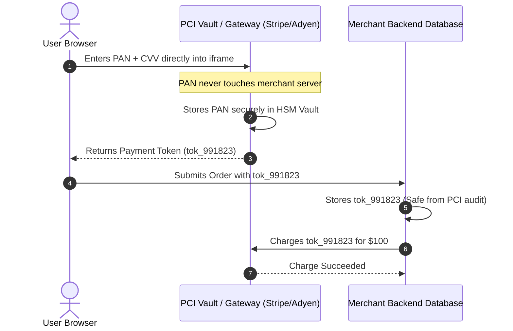
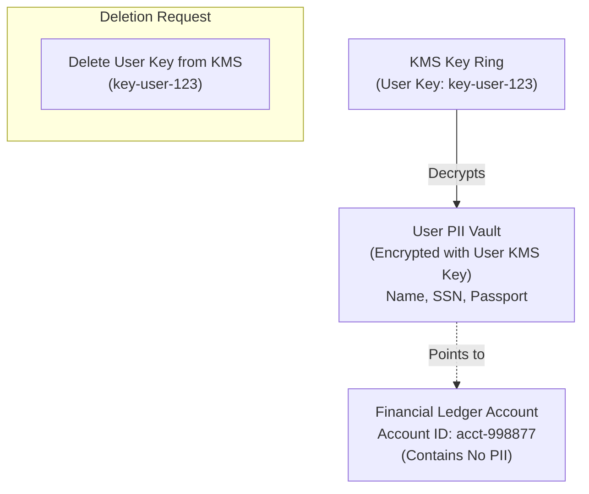

# Compliance, Authentication, and Banking APIs

> Production questions, security standards, and architectural patterns for ISO 20022, Open Banking (FAPI), PCI-DSS tokenization, and KYC/AML isolation.

---

## 1. What is ISO 20022, and why is the global banking industry migrating to it?

### The Core Problem with Legacy Formats
For decades, financial institutions exchanged messages using legacy formats:
- **SWIFT MT messages:** Unstructured text lines with strict character limits (for example: MT103).
- **NACHA files:** 94-character fixed-width plain text lines.
- **Fedwire proprietary messages:** Proprietary binary or character tags.

These legacy formats have critical limitations:
- Remittance data is truncated, making automated reconciliation difficult.
- Names and addresses lack structured fields, causing false positives in sanctions screening.
- Character sets are restricted, preventing non-Latin character usage.

### The ISO 20022 Architecture
ISO 20022 is an international standard for financial messaging. It uses structured XML schemas (and modern JSON translations) organized into business domains:

| Message Code | Business Domain | Function | Common Usage |
| :--- | :--- | :--- | :--- |
| **`pacs.008`** | Payments Clearing & Settlement | Financial Institutional Customer Credit Transfer | FedNow, SEPA, SWIFT Cross-Border |
| **`pacs.002`** | Payments Clearing & Settlement | Payment Status Report (Accept/Reject) | Real-time payment ack/nack |
| **`pain.001`** | Payment Initiation | Customer Credit Transfer Initiation | Corporate treasury batch payments |
| **`camt.053`** | Cash Management | Bank to Customer Statement | End-of-day reconciliation statement |

### Critical Identifier: The UETR
Every ISO 20022 transaction contains a **Unique End-to-end Transaction Reference (UETR)**. 

The UETR is a 36-character UUID (version 4) that must remain unchanged across every bank in the payment chain:

```xml
<CdtTrfTxInf>
    <PmtId>
        <EndToEndId>ORDER-2026-9901</EndToEndId>
        <!-- The UETR must persist across all correspondent banks -->
        <UETR>c1b69785-5b4e-4f51-b94a-39580b03761a</UETR>
    </PmtId>
    <IntrBkSttlmAmt Ccy="USD">50000.00</IntrBkSttlmAmt>
    <Dbtr>
        <Nm>Acme Corporation</Nm>
    </Dbtr>
    <Cdtr>
        <Nm>Global Supplies Ltd</Nm>
    </Cdtr>
</CdtTrfTxInf>
```

---

## 2. How does Open Banking use FAPI (Financial-grade API) and OAuth 2.0?

### Why Standard OAuth 2.0 Fails Banking Security
Standard OAuth 2.0 was designed for low-security operations (such as granting an app access to a photo gallery). In banking systems, standard OAuth 2.0 has severe vulnerabilities:
- **Bearer Token Theft:** If an attacker intercepts a bearer token, they can spend funds immediately.
- **Authorization Request Tampering:** Attackers can alter transaction parameters (destination account or amount) in browser query strings.
- **Token Injection Attacks:** Attackers can inject unauthorized authorization codes into other user sessions.

### Financial-Grade API (FAPI) Security Controls
Open Banking frameworks (such as UK Open Banking, EU PSD2, and Australia CDR) mandate **FAPI 1.0 Advanced** or **FAPI 2.0**.

FAPI enforces four mandatory security controls:

```mermaid
flowchart TD
    Client["Client Fintech App"]
    AuthServer["Bank Authorization Server (AS)"]
    ResourceServer["Bank Core API (RS)"]

    Client -->|1. Pushed Authorization Request (PAR)\nDirect back-channel HTTP POST| AuthServer
    AuthServer -->|2. Returns request_uri| Client
    Client -->|3. Redirects User with request_uri| AuthServer
    AuthServer -->|4. Signs response via JARM (JWT)| Client
    Client -->|5. Exchanges Code for Sender-Constrained Token| AuthServer
    Client -->|6. API Request with mTLS / DPoP Proof| ResourceServer
```

1. **Pushed Authorization Requests (PAR - RFC 9126):**
   - The application does not pass authorization parameters through the browser URL.
   - The application transmits parameters directly to the bank via a back-channel HTTP POST.
   - Prevents parameter tampering and URL sniffing.

2. **Sender-Constrained Access Tokens (DPoP or mTLS):**
   - Tokens are cryptographically bound to the client's private key.
   - **Demonstrating Proof-of-Possession (DPoP - RFC 9449):** The client signs each HTTP request with a unique private key.
   - If a token is stolen, the attacker cannot use it without the client private key.

3. **JWT Secured Authorization Response Mode (JARM):**
   - Authorization responses are returned as signed, encrypted JSON Web Tokens.
   - Prevents code injection and session hijacking.

4. **PKCE Mandatory for All Clients:**
   - Proof Key for Code Exchange (RFC 7636) is mandatory, even for confidential backend servers.

---

## 3. How must financial systems isolate and tokenize cardholder data for PCI-DSS compliance?

### PCI-DSS Scope Reduction
The Payment Card Industry Data Security Standard (PCI-DSS) regulates any system that stores, processes, or transmits cardholder data.

The goal of modern fintech architecture is to **reduce the Cardholder Data Environment (CDE) to zero systems**:

| Data Element | Can Transmit? | Can Process? | Can Store After Authorization? |
| :--- | :--- | :--- | :--- |
| **Primary Account Number (PAN)** | Yes (Encrypted) | Yes | Yes (Must be encrypted/truncated) |
| **Cardholder Name** | Yes | Yes | Yes |
| **Expiration Date** | Yes | Yes | Yes |
| **CVV2 / CVC / CID** | Yes | Yes | **STRICTLY PROHIBITED** |
| **PIN / PIN Block** | Yes (Encrypted) | Yes | **STRICTLY PROHIBITED** |

### Client-Side Tokenization Architecture
To avoid storing PANs in your internal application database, you must use client-side hosted fields or iframes (such as Stripe Elements or Adyen Drop-in):



This pattern qualifies your application for **SAQ A**, the lowest and simplest PCI compliance level.

---

## 4. How do you design data isolation for KYC, AML, and PII regulations?

### The Conflict: GDPR "Right to Be Forgotten" vs. Bank Secrecy Act
Fintech software must comply with two conflicting legal mandates:
1. **Data Privacy (GDPR Article 17):** Users have the legal right to request the deletion of their personal data.
2. **Anti-Money Laundering (BSA / FinCEN / EU AMLD):** Financial institutions must preserve financial records and identity documentation for **5 to 7 years** after account closure.

### The Cryptographic Erasure Solution
You cannot delete ledger postings, because doing so breaks accounting equations and audit trails. 

Instead, you must decouple identity from ledger accounts using **cryptographic erasure**:



When a user submits a GDPR deletion request:
1. The system permanently deletes the customer's encryption key from the Key Management Service (KMS).
2. The PII becomes mathematically impossible to decrypt.
3. The financial ledger entries remain intact with anonymous surrogate keys (`acct-998877`).
4. Both GDPR compliance and AML legal retention rules are satisfied.

---

## 5. How do you design secure webhooks and API authentication for banking integrations?

### Mutual TLS (mTLS) for Bank-to-Bank Connections
Standard TLS only verifies the server identity. Banking APIs require **Mutual TLS (mTLS)**:
- The server presents its certificate to authenticate itself to the client.
- The client presents its client certificate to authenticate itself to the bank.
- Authentication occurs at the network transport layer before any application code executes.

### Production NGINX mTLS Configuration

```nginx
server {
    listen 443 ssl;
    server_name api.bank-partner.com;

    # Server TLS certificate
    ssl_certificate /etc/ssl/certs/server.crt;
    ssl_certificate_key /etc/ssl/private/server.key;

    # Client CA verification
    ssl_client_certificate /etc/ssl/certs/partner-ca.crt;
    ssl_verify_client on;
    ssl_verify_depth 2;

    # Restrict to modern, secure ciphers
    ssl_protocols TLSv1.3;
    
    location /v1/transfers {
        proxy_pass http://internal_banking_upstream;
        proxy_set_header X-Client-DN $ssl_client_s_dn;
    }
}
```

---

## 6. Summary Checklist for Fintech Compliance and Banking APIs

Before launching banking API integrations, verify each compliance requirement:

- [ ] **ISO 20022 Conformance:** All messaging schemas adhere to official XML/JSON schemas with persistent UETR tracking.
- [ ] **FAPI 1.0/2.0 Security:** Open Banking connections implement Pushed Authorization Requests (PAR) and DPoP / mTLS token binding.
- [ ] **Zero PAN Storage:** No Primary Account Numbers or CVVs are stored in core application databases.
- [ ] **Envelope Encryption:** All customer identity and KYC documents are encrypted at rest with dedicated KMS keys.
- [ ] **Cryptographic Erasure:** Account deletion flows destroy user encryption keys while preserving immutable ledger entries.
- [ ] **Mutual TLS Deployed:** Production bank-to-bank endpoints require valid, non-expired client certificates.
