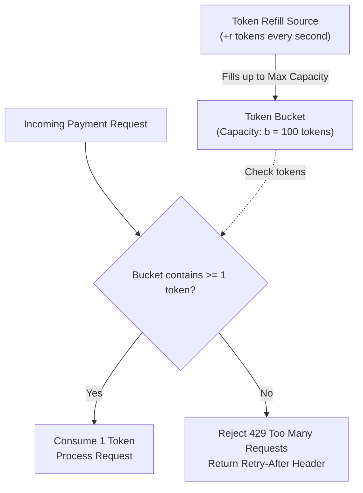
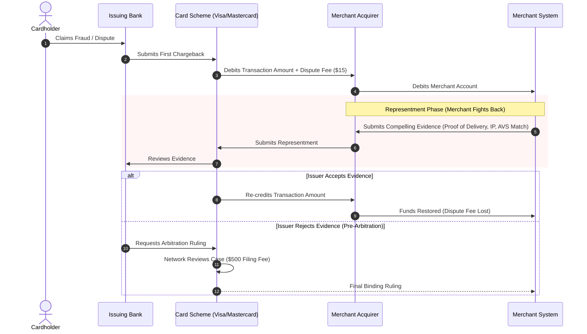
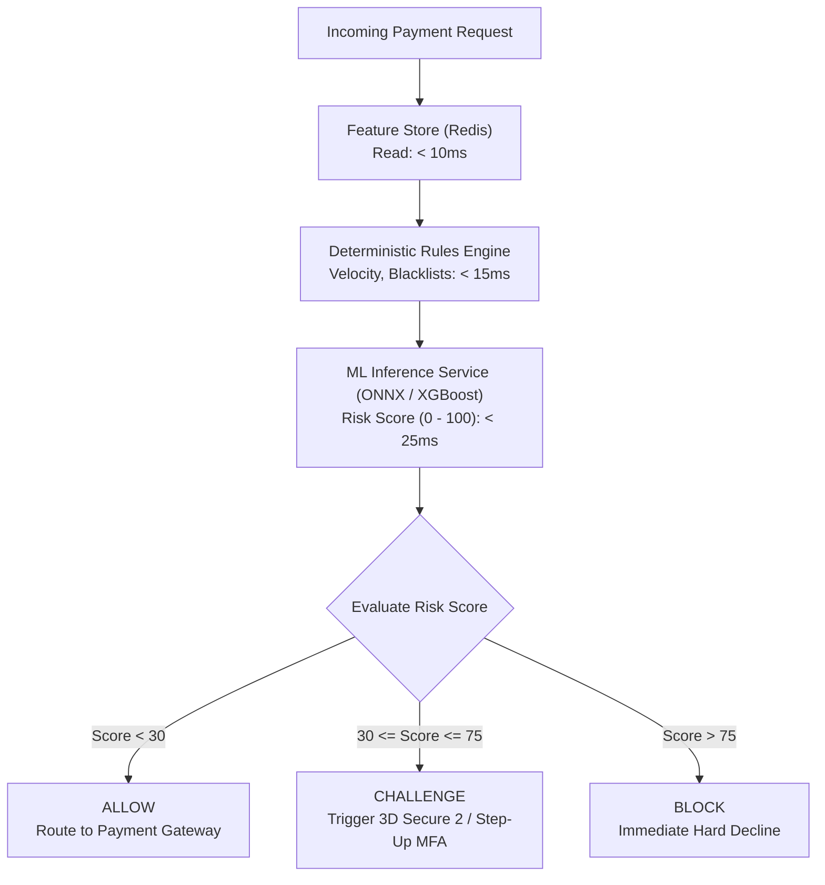

# Fraud, Risk, and Rate Limiting

> Production questions, sliding window velocity algorithms, token bucket rate limiters, chargeback lifecycles, and real-time risk pipelines.

---

## 1. What are velocity checks, and how do you calculate them with sub-millisecond latency?

### The Core Problem: Card Testing Attacks
Fraudsters execute automated **card testing attacks** (card enumeration attacks). 

An attacker steals thousands of stolen credit card numbers. They use automated scripts to test each card by submitting micro-transactions (\$0.50 to \$1.00) against an e-commerce checkout. 

If your application only evaluates transactions individually, an attacker can test thousands of cards per minute. This triggers massive gateway decline fees and card network penalty fines.

Velocity checks calculate the rate of actions over a sliding time window to stop attacks in real time:
- Number of card attempts per IP address within 10 minutes.
- Number of distinct cards attempted per user account within 1 hour.
- Total withdrawal amount attempted per device fingerprint within 24 hours.

### Sliding Window Algorithm with Redis Sorted Sets
A fixed-window counter (for example: hourly buckets) allows double the rate limit across window boundaries. You must implement a **Sliding Window Log** using Redis Sorted Sets:

```mermaid
flowchart LR
    CurrentTime["Current Timestamp: t = 1000"]
    WindowStart["Window Start: t - 600 (600s Window)"]
    
    subgraph Redis Sorted Set: key = velocity:ip:192.168.1.1
        E1["Event 1: score = 350\n(Expired, Pruned)"] -.->|ZREMRANGEBYSCORE| WindowStart
        E2["Event 2: score = 750\n(Retained)"]
        E3["Event 3: score = 920\n(Retained)"]
        E4["Event 4: score = 1000\n(New Event)"]
    end
```

### Production Redis Lua Script for Atomic Velocity Tracking

```lua
-- KEYS[1]: Velocity Tracking Key (e.g., 'velocity:card_attempts:ip_10.0.0.1')
-- ARGV[1]: Current Timestamp in Milliseconds
-- ARGV[2]: Window Size in Milliseconds (e.g., 600000 for 10 minutes)
-- ARGV[3]: Maximum Allowed Attempts (e.g., 5)
-- ARGV[4]: Unique Request UUID

local key = KEYS[1]
local now = tonumber(ARGV[1])
local window = tonumber(ARGV[2])
local max_allowed = tonumber(ARGV[3])
local event_id = ARGV[4]
local clear_before = now - window

-- 1. Remove events older than the sliding window
redis.call('ZREMRANGEBYSCORE', key, '-inf', clear_before)

-- 2. Count current active events in window
local current_attempts = redis.call('ZCARD', key)

-- 3. Check threshold
if current_attempts >= max_allowed then
    return 0 -- Rejected: Velocity Limit Exceeded
end

-- 4. Record new event with current timestamp as score
redis.call('ZADD', key, now, event_id)

-- 5. Set TTL to auto-expire key after window completes
redis.call('PEXPIRE', key, window)

return 1 -- Approved: Under Velocity Limit
```

---

## 2. How do you implement rate limiting with the Token Bucket algorithm?

### Token Bucket vs. Leaky Bucket
Rate limiting protects banking APIs and webhook receivers from infrastructure exhaustion:

1. **Token Bucket Algorithm:**
   - Tokens fill a bucket at a constant rate ($r$ tokens/second).
   - The bucket holds up to a maximum burst capacity ($b$ tokens).
   - Each request consumes one or more tokens.
   - Allows brief bursts of traffic while enforcing long-term rate limits.
   - Ideal for payment APIs and checkout flows.

2. **Leaky Bucket Algorithm:**
   - Requests enter a buffer queue.
   - Requests drain and execute at a strict, uniform rate.
   - Smooths traffic spikes into a constant stream.
   - Ideal for outbound payment rails (such as Fedwire or SWIFT queues).

### Token Bucket Lifecycle



---

## 3. How do chargebacks and disputes work at the card network level?

### Chargeback vs. Refund
- **Refund:** The merchant voluntarily returns funds to the customer. No dispute fees occur.
- **Chargeback:** The cardholder contacts their issuing bank to dispute the charge. The issuer forcibly claws back funds from the merchant.

### The Chargeback Lifecycle



### Card Network Monitoring Programs (Visa VAMP / Mastercard ECP)
Card networks track merchant dispute rates monthly:

$$\text{Dispute Ratio} = \frac{\text{Total Chargebacks in Month}}{\text{Total Completed Transactions in Month}}$$

- **Standard Threshold:** $0.9\%$ dispute ratio and 100 disputes/month.
- **Excessive Threshold:** $1.8\%$ dispute ratio.
- If a merchant breaches the threshold, card networks impose fines of \$50 to \$100 per dispute and can terminate merchant processing privileges permanently.

---

## 4. How do you architect a real-time risk scoring and fraud evaluation pipeline?

### The Latency Budget
A payment gateway must authorize transactions in under 2 seconds. A risk evaluation engine has a strict **50 to 100 millisecond latency budget**.



### Core Risk Signals and Features
1. **Device Fingerprint:**
   - Canvas rendering hash, WebGL parameters, installed fonts, screen resolution.
   - Identifies fraudsters switching user accounts on the same physical computer.

2. **Network and IP Reputation:**
   - Tor exit nodes, residential proxies, VPN detection.
   - **Impossible Travel Velocity:** Rejects logins or purchases when two actions occur at physical locations that require travel speeds greater than $800\text{ km/h}$.

3. **Behavioral Biometrics:**
   - Keystroke dynamics and copy-paste detection on card input fields.
   - Automated bots paste card numbers in milliseconds; humans type with variable cadences.

---

## 5. How does 3D Secure 2 (3DS2) balance fraud prevention with checkout friction?

### Frictionless Flow vs. Challenge Flow
Legacy 3DS1 redirected every user to a slow banking web page, causing high checkout abandonment. 

3D Secure 2 transmits over 100 contextual data points (device fingerprint, shipping address, transaction history) to the card issuer behind the scenes:

- **Frictionless Flow (90%–95% of Transactions):**
  - The issuer determines that the transaction is low risk.
  - Authentication succeeds without presenting any challenge UI to the cardholder.
  - Zero checkout friction.

- **Challenge Flow (High Risk):**
  - The issuer prompts the user for step-up authentication.
  - The user confirms via a banking app push notification, SMS OTP, or biometrics.

### The Liability Shift Rule
When a merchant routes a transaction through 3DS2 and the authentication succeeds:

| Scenario | 3DS Authenticated? | Who Pays for Fraud Chargebacks? |
| :--- | :--- | :--- |
| Standard Card Checkout | No | **Merchant** pays transaction loss + fee |
| 3DS Frictionless Flow Approved | Yes | **Issuing Bank** absorbs fraud loss (**Liability Shift**) |
| 3DS Challenge Completed | Yes | **Issuing Bank** absorbs fraud loss (**Liability Shift**) |
| 3DS Unavailable by Issuer Rail | Yes (Attempted) | **Issuing Bank** absorbs fraud loss (**Liability Shift**) |

> [!IMPORTANT]
> The liability shift only covers **fraud reason codes** (unauthorized transactions). It does not protect merchants against product quality disputes, missing items, or cancellation disagreements.

---

## 6. Summary Checklist for Fraud, Risk, and Rate Limiting Systems

Before releasing financial checkout systems to production, verify each defense:

- [ ] **Atomic Velocity Limits:** Sliding window counters track IP addresses, card fingerprints, and device IDs in Redis.
- [ ] **Card Testing Protections:** Repeated checkout failures trigger CAPTCHA or hard IP blocks before network fees accumulate.
- [ ] **Token Bucket Limits:** Rate limiters protect core banking and payment mutating endpoints with proper `Retry-After` headers.
- [ ] **3DS2 Liability Shift:** Card payment flows invoke 3D Secure 2 to shift fraud chargeback liability to issuing banks.
- [ ] **Dispute Ratio Monitoring:** Automated alerts notify operations when dispute ratios approach $0.65\%$ (to avoid card scheme fines at $0.9\%$).
- [ ] **Real-Time Latency Enforced:** The risk evaluation pipeline completes scoring and feature retrieval within a 100 ms SLA.
